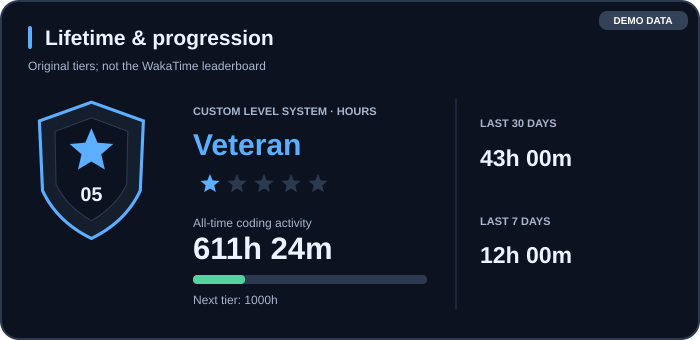
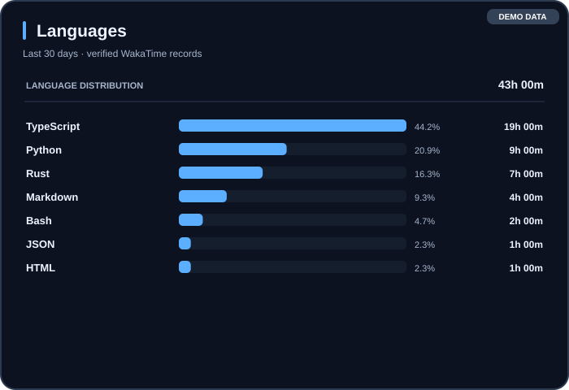
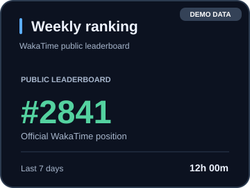
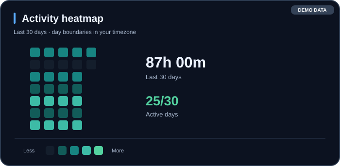

<div align="center">
  

  # AXR Stats

  **Developer activity, rendered with identity.**

  Minimal, customizable SVG stats, seven original rank sigils, and a portable GitHub Action for developer profiles.

  
  
  
  
</div>

> [!IMPORTANT]
> **Early preview**, not a stable release. The source is available here, but no `@v1` release tag exists yet; the example Action reference will only work after that tag is published.

## ✦ Preview

<div align="center">
  
  
  
  
  
</div>

<sub>Previews use **fictional demonstration data** and are **not** stats from a real WakaTime account.</sub>


**Rank artwork:** Seven original AI-generated illustration crops are included as transparent PNGs under `assets/badges/*.png`. The previous SVG rank shapes remain available as experimental vector alternatives. The PNGs were extracted from a generated concept composition; they are the first raster art iteration, not hand-painted exports.

## Features

| Cards | What they show | Source |
| --- | --- | --- |
| Lifetime | Total logged time, level and star progress | WakaTime + custom tier rules |
| Languages | All-time language breakdown | WakaTime |
| Ranking | Verified public leaderboard position, if available | WakaTime |
| Heatmap | 30 days of activity | WakaTime |
| Emblem | Custom shield, level and stars | AXR Stats |

- **Seven image-generated PNG rank medals** with distinct metallic finishes, faceted gems and tier silhouettes.
- All-time language stats via the official WakaTime `stats/all_time` endpoint; daily summaries remain 30 days.
- Dedicated daily activity gauge with safe spacing.
- An informational GitHub Pages website for ranks, guides and project roadmap.
- Three included themes: `midnight`, `graphite`, `aurora`.
- Python standard library only — no image hosting or `pip install` required.
- Privacy-oriented: OAuth token goes only to the **official WakaTime API**.
- XML validation before output; malformed stats do not replace previously committed cards.
- Every custom score is clearly labeled as such; an unavailable official rank is never invented.

## Site & documentation

A static, responsive documentation website is included in [`site/`](site/). Once GitHub Pages is enabled using **GitHub Actions** as the deployment source, the site can deploy automatically at [axrobert.github.io/axr-stats/](https://axrobert.github.io/axr-stats/). Until then, it is source code, not a confirmed live URL. The site contains only demonstration data; OAuth tokens must never be stored in web JavaScript.

## Quick start

1. Create an OAuth personal token at [WakaTime OAuth](https://wakatime.com/oauth) with permissions to read your stats. Do **not** use an editor plugin API key.
2. Store it in **Settings → Secrets and variables → Actions** as `WAKATIME_OAUTH_TOKEN` in your own repository.
3. Copy the example in [`examples/consumer-workflow.yml`](examples/consumer-workflow.yml) to `.github/workflows/axr-stats.yml` in the consuming repository.
4. **Once a v1 release is published**, the reference `axrobert/axr-stats@v1` can be used (pinning a commit SHA is more secure). Until then, the sample workflow is instructional only.
5. Add the generated SVGs from `assets/axr-stats/` to your profile README.

Example README embedding after workflow output is available:

```md


```

## Local development

```bash
python -m unittest discover -s tests -v
export WAKATIME_OAUTH_TOKEN='your-token'  # never commit a token
python src/axr_stats.py --theme midnight --timezone America/Maceio --output dist
```

On Windows PowerShell, use `$env:WAKATIME_OAUTH_TOKEN = 'your-token'` instead of `export`.

## Folder structure

```text
axr-stats/
├── .github/workflows/       # project tests
├── assets/
│   ├── brand/              # logo + banner
│   ├── icons/              # original minimalist vectors
│   ├── badges/             # rank art
│   └── previews/           # fictional demo SVGs
├── docs/                   # design system, API/security, roadmap, Portuguese guide
├── examples/               # consumer workflow + README snippet
├── src/axr_stats.py        # renderer and official WakaTime API client
├── tests/                  # offline tests
├── action.yml              # composite GitHub Action
└── README.md
```

## Roadmap

- [x] Working prototype inside `axrobert/axrobert`
- [x] Lifetime time + verified public leaderboard + original tier badges
- [x] Standalone starter scaffold
- [x] Create the separate `axrobert/axr-stats` repository
- [ ] Cross-platform visual QA, badge export variants and GitHub Action v1 tag
- [x] Original seven-tier rank sigils, documentation website source and lifetime languages
- [ ] Configuration schema, color picker and hosted preview editor
- [ ] Optional GitHub metrics and extra integrations, with clear source labels

**Project:** [github.com/axrobert/axr-stats](https://github.com/axrobert/axr-stats)

**Privacy and documentation:** [SECURITY.md](docs/SECURITY.md) · [Design system](docs/DESIGN_SYSTEM.md) · [Roadmap](docs/ROADMAP.md) · [Guia PT-BR](docs/pt-BR.md)

---

<sub>AXR Stats is an independent project. Not affiliated with GitHub or WakaTime. Built with assistance from AI and curated by the project maintainer. No license granted yet: source is publicly visible but not currently licensed for redistribution. A public open-source license will be selected before v1.</sub>
