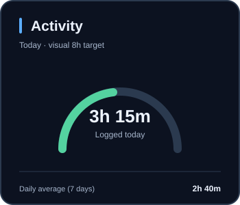

<div align="center">


# AXR Stats

**Your coding journey, beautifully documented.**

Cards de programação, evolução por horas e medalhas personalizadas para perfis GitHub.


[**Website**](https://axrobert.github.io/axr-stats/) · [**Documentação**](https://axrobert.github.io/axr-stats/docs/) · [Instalação](https://axrobert.github.io/axr-stats/docs/installation/) · [Ranks](https://axrobert.github.io/axr-stats/docs/ranks/) · [Roadmap](https://axrobert.github.io/axr-stats/roadmap/) · [Personalizar](https://axrobert.github.io/axr-stats/customize/)

</div>

## Preview

<p align="center"><sub>DEMONSTRATION DATA — fictional values, not real account statistics.</sub></p>

<table>
<tr>
<td align="center" width="30%" valign="middle">
  
  <p><strong>ESTUDANTE · TIER 03</strong></p>
  <sub>150+ cumulative hours</sub>
</td>
<td width="70%" valign="middle">
  <h3>Make progress visible.</h3>
  <p>Track your lifetime coding time, your most-used languages and your daily activity, with optional verified WakaTime leaderboard results.</p>
  <p>The rank system is original to AXR Stats; the medals are replaceable PNGs. Charts use generated SVGs for sharp text and dynamic data.</p>
</td>
</tr>
</table>

<p align="center"></p>
<p align="center">
  
  
</p>
<p align="center"></p>

## Features

| Card | Shows |
| :--- | :--- |
| **Lifetime** | Tracked hours, custom tier, stars and progress |
| **Languages** | All-time language distribution from WakaTime |
| **Activity** | Today’s coding time and recent daily average |
| **Ranking** | Public WakaTime position, when verifiable |
| **Heatmap** | Past 30 days of activity |
| **Emblem** | Transparent, replaceable rank illustration |

Three themes are available: **Midnight**, **Graphite**, and **Aurora**. The Action reads the official WakaTime API using an OAuth token from GitHub Actions Secrets. The token is never placed in public images.

## Rank progression — 12 illustrated tiers

<div align="center">
  
  
  
  
  
  
  
  
  
  
  
  
</div>

| Tier | Rank | From (hours) | Until (exclusive) |
| :--: | :--- | ---: | ---: |
| 01 | Iniciante | 0 | 50 |
| 02 | Aprendiz | 50 | 150 |
| 03 | Estudante | 150 | 300 |
| 04 | Desenvolvedor | 300 | 500 |
| 05 | Especialista | 500 | 800 |
| 06 | Avançado | 800 | 1,200 |
| 07 | Elite | 1,200 | 1,800 |
| 08 | Mestre | 1,800 | 2,500 |
| 09 | Arquiteto | 2,500 | 3,500 |
| 10 | Sábio | 3,500 | 5,000 |
| 11 | Lendário | 5,000 | 8,000 |
| 12 | Soberano | 8,000 | ∞ |

The **12-level system** is original to AXR Stats and uses tracked programming hours, not an official WakaTime or GitHub rank. The current 12 images come from the maintainer's **corrected November 2026 ZIP** (rank 07 uses `Elite_CORRIGIDO`). Web-ready PNGs are square (320–384 px) with transparency; originals are not silently overwritten outside the current asset directory. SVG wrappers with embedded raster pixels are available under [assets/badges/current/](assets/badges/current/); they are not editable vector paths.

The rank catalog is maintained in [ranks.json](assets/badges/current/ranks.json). Earlier provisional graphics remain in the legacy directory for reference.


### Arte atualizada — coleção de 12 ranks

Todos os emblemas da coleção foram substituídos pelos arquivos corrigidos fornecidos pelo mantenedor. Os nomes e os limites de horas permanecem os mesmos. Os `*.svg` desta coleção contêm PNG incorporado (não são vetores editáveis). Confira os ícones na [galeria do site](https://axrobert.github.io/axr-stats/#ranks) e o [roadmap visual](https://axrobert.github.io/axr-stats/roadmap/).

### Ícones do roadmap

A página [Roadmap](https://axrobert.github.io/axr-stats/roadmap/) agora usa cinco insígnias de criação própria em `site/roadmap/icons/`. Cada ícone tem **SVG com caminhos vetoriais nativos** e um **PNG transparente otimizado** gerado a partir dele. Os ícones são independentes dos 12 emblemas de ranking.

## Personalização — Fase 2 (prévia)

**Fase 2.4 (em validação):** o personalizador separa ajustes básicos e avançados, importa `axr-stats.json` localmente com validação estrita e oferece opções de fuso/saída. O card Atividade também teve seu medidor realinhado para evitar colisão com o texto.


[**Experimentar os seis cards no site**](https://axrobert.github.io/axr-stats/customize/) · Visualização dos SVGs renderizados pelo mesmo Python usado na Action, com **dados fictícios**. O navegador modifica apenas tokens válidos de cor. Sem OAuth, telemetria ou chamadas à API do WakaTime.

Você pode manter os temas padrão ou fornecer um arquivo [`axr-stats.json`](examples/axr-stats.json) para selecionar tema, fuso, diretório de saída, cards publicados, organização do README, largura de exibição e ajustar cores dos cards via tokens `#RRGGBB`, **sem editar o código**.

```bash
python src/run_action.py --config examples/axr-stats.json
```

Se o JSON contiver `layout` ou `size`, o gerador também publica um `README-snippet.md` com imagens relativas à pasta de saída. Copie esse trecho para seu perfil depois de executar a Action. Sem configuração, o comportamento antigo (seis SVGs e dois PNGs) é mantido.

Veja os campos aceitos em [Configuração de temas](docs/THEME_CONFIG.md). O arquivo não deve conter tokens ou credenciais. A configuração por JSON e a prévia dos seis SVGs com exportação local estão disponíveis. Seleção de cards publicados, layouts de README vertical ou duas colunas, e largura compacta/padrão/ampla já estão disponíveis. Fase 2.3.1: o parâmetro `language_rows` controla 5, 8 ou 10 linhas do **SVG de Linguagens**, ajustando sua altura; o padrão 10 mantém o layout anterior. Fase 2.3.2: `typography` (compact/standard/large) e `show_rank_stars` (true/false) permitem ajustar escala de textos e estrelas internas sem alterar os dados. Fase 2.3.3: `show_card_subtitles` (true/false) permite ocultar a descrição secundária sob os títulos de todos os cards, mantendo as métricas e artes. Outros arranjos internos continuam planejados.

## Quick start

**Novo no GitHub?** Use o [guia passo a passo para iniciantes](docs/GETTING_STARTED.md). Ele explica como criar o repositório de perfil, salvar o OAuth como Secret, executar a Action e adicionar os cards ao README.


> [!IMPORTANT]
> **Development preview:** The reusable Action has no stable v1 tag yet. The sample workflow uses the mutable `@main` ref for **preview testing only**, not a stable release. Pin a reviewed full commit SHA before relying on it in production.

1. Generate a personal OAuth token at [WakaTime OAuth](https://wakatime.com/oauth). An editor API key is not a substitute.
2. Add the token as the repository Actions secret **WAKATIME_OAUTH_TOKEN**.
3. Review the [consumer workflow](examples/consumer-workflow.yml), the [beginner setup guide](docs/GETTING_STARTED.md) and [security guidance](docs/SECURITY.md).
4. For local testing, run Python unit tests and the generator:

    python -m unittest discover -s tests -v

    python -m pip install -r requirements-runtime.txt

    python src/run_action.py --theme midnight --timezone America/Maceio --output dist

The second command requires the WAKATIME_OAUTH_TOKEN environment variable. **Never commit or share its value.** The PNG composer uses Pillow and CairoSVG; see the [Action definition](action.yml).

## Repository layout

| Path | Contents |
| :--- | :--- |
| [src/](src/) | Official WakaTime API client and image renderers |
| [assets/badges/](assets/badges/) | Current 12-rank PNG/SVG collection |
| [assets/badges/legacy/](assets/badges/legacy/) | Archived experimental SVG badges |
| [assets/previews/](assets/previews/) | Fictional sample graphics; never real user data |
| [scripts/generate_preview_cards.py](scripts/generate_preview_cards.py) | Deterministic fixture output from production Python renderer for GitHub Pages |
| [site/customize/](site/customize/) | Browser preview of six SVG cards, with theme token recoloring and JSON export |
| [assets/brand/](assets/brand/) | Branding |
| [site/](site/) | GitHub Pages source |
| [docs/](docs/) | Documentation and design rules |
| [examples/](examples/) | Consumer workflow and profile snippet |
| [tests/](tests/) | Regression and asset checks |

## Status, contribution & support

The prototype is running on the maintainer's profile and the documentation website is published at [axrobert.github.io/axr-stats](https://axrobert.github.io/axr-stats/). Offline consumer integration tests and cross-platform visual QA are available. The separate [profile repository successfully ran the pinned Action in an isolated consumer smoke test](https://github.com/axrobert/axrobert/actions/runs/42962893687), validating six SVGs and two PNGs without modifying the profile. Cross-account coverage, dependency pinning and licensing remain release gates.

See [Contributing](CONTRIBUTING.md), [Design system](docs/DESIGN_SYSTEM.md) and [Roadmap](docs/ROADMAP.md). Support links will be added after the maintainer configures an official donation account.

**Licensing:** No license granted yet. The code and generated art need an explicit licensing decision before v1. Publicly visible does not mean freely redistributable.

<sub>Independent project. Not affiliated with GitHub or WakaTime. Built with AI assistance and human curation.</sub>
